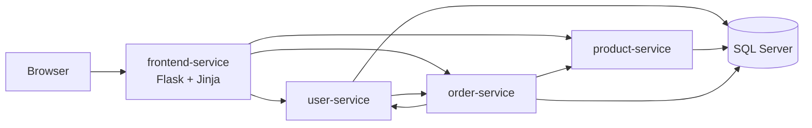

# Web shop on Kubernetes: microservices with a full test suite

A small online shop built from four Python/Flask microservices and a SQL
Server database, running on Kubernetes in Docker Desktop. It comes with
documented requirements and test cases, and an automated test suite at three
levels: unit, integration and end-to-end (Playwright).

Originally the examination project of the *Applied Scripting* course in an IT
Test Specialist programme, since extended with a test strategy, test cases and
test automation.

**Contents:** [What the shop does](#what-the-shop-does) ·
[Quick start](#quick-start) · [Running the tests](#running-the-tests) ·
[Testing approach](#testing-approach) · [How it works](#how-it-works) ·
[Project structure](#project-structure) · [How AI was used](#how-ai-was-used) ·
[Troubleshooting](#troubleshooting)

---

## What the shop does

A customer can:

- **register** an account and **log in** (passwords are stored as salted hashes)
- **browse** products with price and stock
- **add products to a cart**, change it, and keep it when logging in
- **check out** with a post code and delivery method (pickup at the store
  free, delivery to the door $5.00) and get a **receipt**
- **delete their account** (their orders are kept, anonymized)

Behind the pages, the shop makes sure that:

- nobody can buy more than is in stock, even when many customers order the
  last items at the same moment
- an order is **all-or-nothing**: if one product is sold out, nothing is
  ordered and nothing is charged
- clicking *Place Order* twice creates **one** order
- the internal services only accept each other, and each service can only
  touch its own data

Payment and e-mail are mocked.

---

## Quick start

### 1. Install the requirements

- **Docker Desktop** with Kubernetes switched on (Settings → Kubernetes →
  Enable Kubernetes). Tested with the *kind* cluster type, Kubernetes 1.36.
  Give Docker at least 4 GB of memory; SQL Server alone may use up to 2.5 GB.
- **kubectl**: comes with Docker Desktop. Check with `kubectl version`.
- **Python 3** with pip (tested with Python 3.14).

### 2. Deploy the shop

From the project folder:

```bash
python deploy.py
```

This builds the images, creates random passwords in a Kubernetes Secret (the
first time only), starts SQL Server and the four services, creates the
database, and waits until everything is ready. It takes a few minutes the
first time. Running it again is safe: data is kept, and nothing changes if the
code did not change.

### 3. Open the shop

```bash
kubectl port-forward service/frontend-service 8080:80
```

Leave that running and browse to **http://localhost:8080**.

You can register your own account, or use a seed account (created on a fresh
database):

| Email | Password |
|---|---|
| alice.anderson@example.com | Pass12345 |
| brian.bergstrom@example.com | SecurePass9 |
| clara.carlsson@example.com | MyPassword123 |

### 4. Stop and clean up

Delete everything from the cluster, including the database (fresh start next
time):

```bash
python cleanup.py
```

`python cleanup.py --keep-data` keeps the database; `--purge` also deletes the
Secret, so the next deploy gets new passwords.

---

## Running the tests

Install the test dependencies and the browser for the E2E tests (once):

```bash
pip install -r tests/requirements.txt
```

```bash
playwright install chromium
```

| What | Command | Needs | Time |
|---|---|---|---|
| Unit tests | `pytest` | nothing (no Docker) | ~2 s |
| Integration tests, without the slow ones | `pytest tests/integration -m "not disruptive"` | deployed shop | ~1 min |
| All integration tests | `pytest tests/integration` | deployed shop | ~4 min |
| E2E tests in a browser | `pytest tests/e2e` | deployed shop | ~30 s |
| Everything: deploy, all tests, cleanup | `python run.py` | Docker Desktop | ~8 min |

- Watch the browser while the E2E tests run: `pytest tests/e2e --headed --slowmo 300`
- `python run.py --quick` skips the slow tests; `--keep` leaves the shop running.
- The *disruptive* integration tests stop the database and run `deploy.py`
  twice, to prove that data survives and that a redeploy is safe.

**Results** are written to `reports/`:

- `test-case-results.csv`: one row per test case ID with Pass / Fail / Blocked,
  ready to paste into the Test Results sheet of
  [test-management.xlsx](docs/v1.1/test-management.xlsx)
- `junit.xml`: machine-readable results (when run through `run.py`)

---

## Testing approach

| Level | What it proves | Tool | Test cases |
|---|---|---|---|
| Unit | One service's logic in isolation; database and other services faked | pytest + Flask test client | 40 |
| Integration | Real parts together: services, SQL Server, Kubernetes | pytest + requests, kubectl, sqlcmd | 41 |
| E2E | Customer journeys in a real browser | pytest + Playwright | 21 |
| Static | Review of code and configuration | by hand | 1 |

- **Traceability.** [test-management.xlsx](docs/v1.1/test-management.xlsx) holds 41
  requirements, 103 test cases (one sheet per level), test results and a
  summary. Every automated test carries its test case ID, so results map
  straight back to requirements.
- **Test design techniques:** boundary value analysis, equivalence
  partitioning, decision tables, state transitions, concurrency and
  negative testing.
- **Beyond the happy path:** overselling under parallel orders, double
  submission, all-or-nothing orders across services, security (service token,
  CSRF, rate limiting, network isolation, database permissions, XSS) and
  resilience (database outage, restarts, redeploys).
- **Latest result:** 208 of 208 automated tests passed, and the static review
  passed: all 103 test cases Pass, covering all 41 requirements.
- **Test report.** [test-report.pdf](docs/v1.1/test-report.pdf) closes the testing:
  scope, results, defects, deviations, remaining risks and a recommendation.

Tests are written to be read. Each step is commented in Given / When / Then
form where it fits:

```python
@pytest.mark.tc("E2E-018")
def test_product_sells_out_before_you_check_out(page, new_user, set_stock, start_logged_in, orders_of):
    # Given a logged-in customer (test helper)
    ...
    # When they add 2 JBL 775 NC to the cart
    add_to_cart(page, "JBL 775 NC", 2)
    # And the stock drops to 1 before they check out (test helper)
    set_stock(JBL, 1)
    ...
    # Then they are told why, and that nothing was charged
```

---

## How it works



| Service | Responsibility |
|---|---|
| frontend-service | Web pages, session, cart, checkout |
| user-service | Registration, login, account deletion |
| product-service | Products and stock (stock is checked and changed in one atomic step) |
| order-service | Orders with order lines, all-or-nothing across services, double-submit protection |
| SQL Server | One database and one login per service, on a persistent volume |

---

## Project structure

```
.
├── services/
│   ├── common/servicekit.py       shared code: service token, request IDs, database access
│   ├── frontend-service/          app.py, templates/, Dockerfile
│   ├── user-service/              app.py, Dockerfile
│   ├── product-service/           app.py, Dockerfile
│   └── order-service/             app.py, Dockerfile
├── k8s/                           Kubernetes manifests (incl. database schema, network policies)
├── tests/
│   ├── unit/                      unit tests (database and HTTP faked)
│   ├── integration/               integration tests (need the deployed shop)
│   └── e2e/                       Playwright browser tests (need the deployed shop)
├── docs/                          test documents, one folder per release
│   └── v1.1/
│       ├── test-management.xlsx   requirements, test cases, results
│       ├── test-report.pdf        test report (also as .docx)
│       └── test-report.docx
├── deploy.py                      one-command deploy
├── cleanup.py                     remove everything from the cluster
├── run.py                         deploy -> all tests -> cleanup
├── docker-compose.yaml            builds the images
└── pytest.ini                     pytest settings and markers
```

---

## How AI was used

AI was used as a development tool, to spend less time on writing code and more
on testing it. It was used in two stages.

**1. Building the application.** The shop was built from a detailed
requirements specification with the help of AI. That made it possible to have
four working microservices, the database and the Kubernetes setup in a short
time. The application was later reviewed and hardened with Claude Code
(Anthropic's AI coding assistant): input validation, password hashing, atomic
stock updates, secrets, and network and database permissions.

**2. Automating the tests.** Claude Code was used to help turn the test cases
in [test-management.xlsx](docs/v1.1/test-management.xlsx) into automated pytest
code: unit tests with faked dependencies, integration tests against the
deployed cluster, and Playwright tests for the browser. Every test carries the
ID of the test case it automates and follows its steps. The suite was run
against the deployed system, and checked by deliberately introducing bugs into
the code to confirm that the tests catch them.

---

## Troubleshooting

**`deploy.py` stops at "Waiting for the database to be initialized".**
Show the database init job's log:

```bash
kubectl logs job/db-init-job
```

The job waits up to three minutes for SQL Server. If SQL Server itself does
not start, check its pod with `kubectl get pods` and
`kubectl describe pod <mssql pod name>`.

**Pods stay in `Pending`.** Usually not enough memory: raise Docker Desktop's
memory limit (Settings → Resources).

**Tests fail with "The system is not deployed".** Run `python deploy.py`
first.

**"Port already in use".** The tests use local ports 15001-15003 and 18080;
the shop is usually opened on 8080. Stop whatever uses the port.

**Login says "Too many attempts".** Login and registration allow 5 attempts per
minute. Wait a minute.

**The database and the Secret belong together.** A database created with one
set of passwords cannot be used with another. That is why `cleanup.py` keeps
the Secret unless you pass `--purge`, and `--purge` cannot be combined with
`--keep-data`.

---

## Known limitations

Deliberate for a local demo: no HTTPS, a self-signed database certificate,
rate limits counted per pod, one shared token between the services, and
mocked payment and e-mail.

---

## License

MIT, see [LICENSE](LICENSE).
